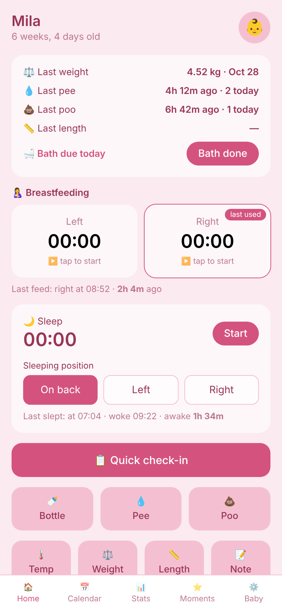
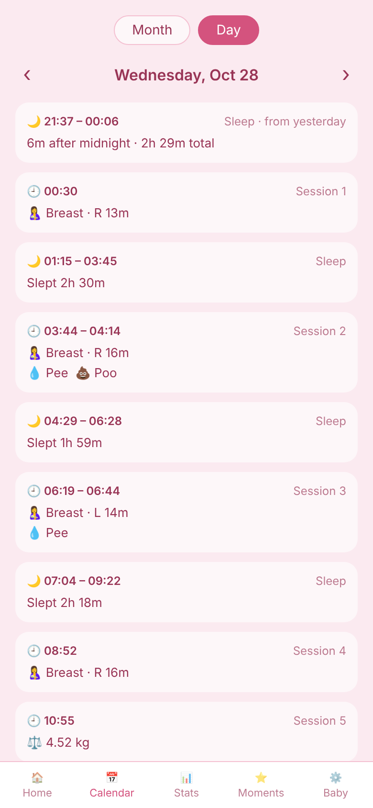
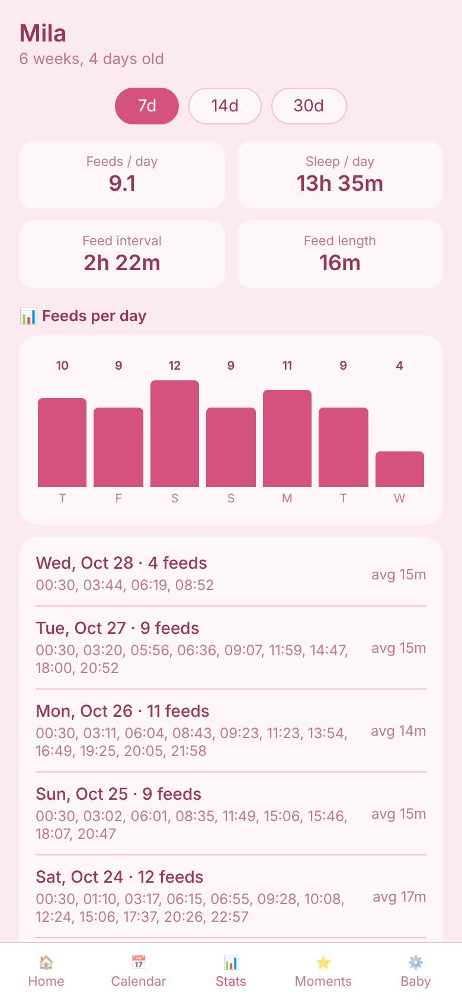

# 👶 BabyLog

A small, self-hosted newborn tracker for both parents' phones: feeds, sleep, diapers,
weight, milestones. Flask + SQLite on your own server, a single-page web app on the phone
(add it to the home screen and it behaves like an app). No accounts, no cloud, no tracking —
one SQLite file holds everything.

<p align="center">
  
  
  
</p>

## Features

- **Breastfeeding timers** (left / right, remembers the last side) and a **sleep timer** with
  sleeping position. Timers run on the server, so they survive closing the app and are shared
  between phones.
- **One-tap logging:** bottle (ml), pee, poo, temperature, weight, length, notes, quick check-in.
- **At a glance:** last weight, last pee/poo with today's count, time since last feed and sleep,
  bath reminder.
- **Calendar:** month grid plus a detailed per-day table with daily totals.
- **Stats:** 7 / 14 / 30-day feed and sleep averages, feed interval and length, feeds-per-day chart,
  weight trend.
- **Moments:** milestone photos (stored as files next to the database).
- Baby profile with live age and a girl/boy colour theme; multiple babies.
- Auto-refresh, so a partner's entries appear on your phone within seconds.
- JSON export.

## Quick start (Docker)

```bash
git clone https://github.com/Zippoman777/babylog.git && cd babylog
cp .env.example .env
python3 -c "import secrets; print('BABYLOG_SECRET=' + secrets.token_hex(32))" >> .env
mkdir -p data          # create it yourself so the container (uid 1000) can write to it
docker compose up -d --build
```

Open http://localhost:8000. Data lives in `./data` (`babylog.db` + `photos/`) — back that folder up.

To require a password, add a hash to `.env` and restart:

```bash
python3 -c "from werkzeug.security import generate_password_hash as h; print('BABYLOG_PASSWORD_HASH=' + h('your-password'))" >> .env
docker compose up -d
```

## Run locally (no Docker)

```bash
python -m venv .venv
# Windows:  .venv\Scripts\activate     Linux/macOS:  source .venv/bin/activate
pip install -r requirements.txt
python app.py                      # http://127.0.0.1:8000
```

To try it on your phone on the same Wi-Fi: `HOST=0.0.0.0 python app.py`, then open
`http://<your-PC-LAN-IP>:8000`.

## Configuration

| Variable | Default | |
|---|---|---|
| `BABYLOG_DB` | `babylog.db` next to `app.py` | SQLite file |
| `BABYLOG_PHOTOS` | `photos/` next to the database | milestone photos |
| `PORT`, `HOST` | `8000`, `127.0.0.1` | dev server only |
| `BABYLOG_DEBUG` | off | Flask debugger for development — never on a reachable port |

## Security (set these before exposing it to the internet)

The app is **open** with no config (fine on a private LAN). For public hosting:

- `BABYLOG_PASSWORD_HASH` — enables login. Generate a hash:
  ```bash
  .venv/bin/python -c "from werkzeug.security import generate_password_hash as h; print(h('YOUR-PASSWORD'))"
  ```
  (Or `BABYLOG_PASSWORD=plaintext` for quick tests — the hash form is preferred.)
- `BABYLOG_SECRET` — random hex to sign session cookies (`python -c "import secrets;print(secrets.token_hex(32))"`). Set it so logins survive restarts.
- `BABYLOG_SECURE_COOKIES=1` — send cookies only over HTTPS and enable HSTS. Turn on once TLS works.
- `BABYLOG_ALLOWED_COUNTRIES=EE,FI` — geo-block: allow only these countries. Needs Cloudflare in front (sends `CF-IPCountry`) or a GeoIP DB.
- `BABYLOG_GEOIP_DB=/path/GeoLite2-Country.mmdb` — optional local GeoIP DB (then `pip install geoip2`).
- `BABYLOG_SESSION_DAYS` (default 30), `BABYLOG_LOGIN_MAX_FAILS` (8), `BABYLOG_LOGIN_WINDOW` (900s), `BABYLOG_RATE_MAX` (600), `BABYLOG_RATE_WINDOW` (60s).

**What's built in:** password login with signed sessions · brute-force lockout
on repeated bad passwords · per-IP request rate limiting · CSRF protection on
writes · geo-blocking · hardened headers (CSP, HSTS, X-Frame-Options, nosniff)
· Secure/HttpOnly/SameSite=Strict cookies · 1 MB request cap.

## Deploy on Ubuntu (systemd + nginx)

```bash
sudo useradd -r -m -d /opt/babylog babylog
sudo -u babylog git clone https://github.com/Zippoman777/babylog.git /opt/babylog
cd /opt/babylog
sudo -u babylog python3 -m venv .venv
sudo -u babylog .venv/bin/pip install -r requirements.txt
sudo -u babylog cp .env.example babylog.env
sudo -u babylog .venv/bin/python set_password.py babylog.env
# add BABYLOG_SECRET to babylog.env (see .env.example), and BABYLOG_SECURE_COOKIES=1 once HTTPS works

sudo cp deploy/babylog.service /etc/systemd/system/
sudo systemctl daemon-reload && sudo systemctl enable --now babylog

sudo apt install -y nginx certbot python3-certbot-nginx
sudo cp deploy/nginx-babylog.conf /etc/nginx/sites-available/babylog   # edit server_name
sudo ln -s /etc/nginx/sites-available/babylog /etc/nginx/sites-enabled/
sudo nginx -t && sudo systemctl reload nginx
sudo certbot --nginx -d your-domain.example
```

Then open the HTTPS address in Safari/Chrome → Share → **Add to Home Screen**.

## Hardening the server (recommended for public hosting)

App-level auth is only one layer. For a box on the open internet, also do:

1. **Firewall** — allow only SSH + web:
   ```bash
   sudo ufw allow OpenSSH && sudo ufw allow 'Nginx Full' && sudo ufw enable
   ```
2. **fail2ban** — bans IPs that hammer SSH (and can watch nginx too):
   ```bash
   sudo apt install -y fail2ban && sudo systemctl enable --now fail2ban
   ```
3. **Cloudflare (free) in front** — the easiest strong layer: hides your IP,
   absorbs DDoS, provides a WAF, and sends the `CF-IPCountry` header that powers
   `BABYLOG_ALLOWED_COUNTRIES` geo-blocking. Proxy the DNS record (orange cloud)
   and set SSL mode to "Full (strict)". You can also geo-block at Cloudflare's
   edge so bad traffic never reaches your server at all.
4. **SSH keys only** — disable password login in `/etc/ssh/sshd_config`
   (`PasswordAuthentication no`).
5. **Keep it patched** — `sudo apt update && sudo apt upgrade`, enable
   `unattended-upgrades`.
6. **Back up** `babylog.db` regularly (it holds everything).

With `BABYLOG_PASSWORD_HASH` set, HTTPS on, and Cloudflare in front with a
country allow-list, only people who know the password — from allowed countries —
can reach the log, and brute-force attempts get locked out.

## Data & backup

Everything is in the SQLite file plus the `photos/` folder next to it. Back them up by copying,
or use **Export data** in the app. Deleting a baby deletes all of their events and timers.

## License

[MIT](LICENSE)
